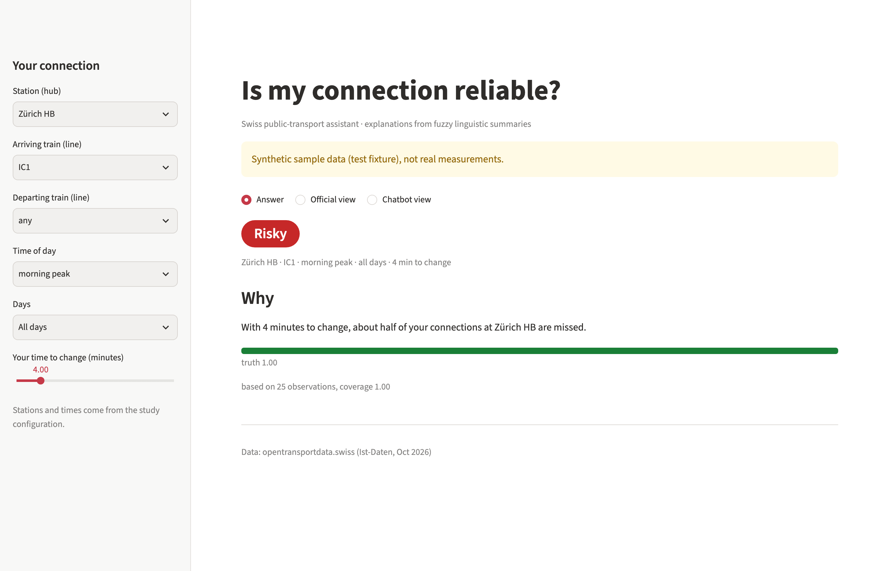
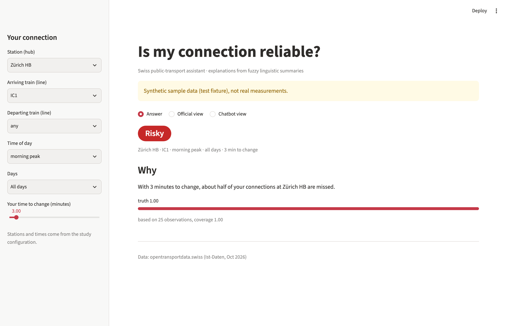
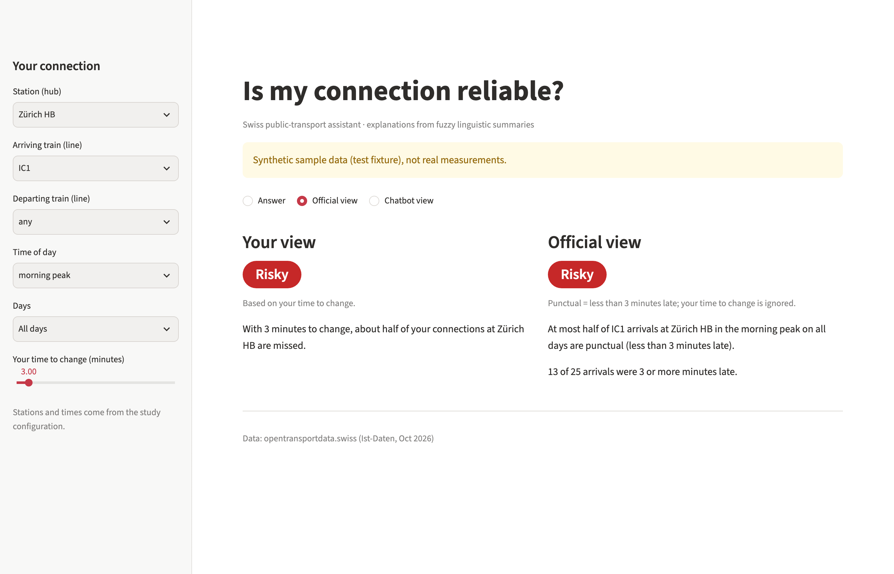
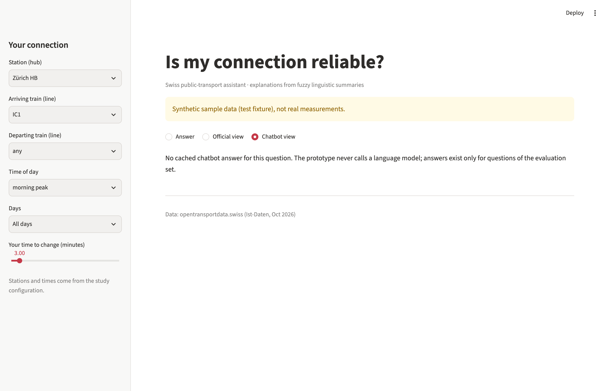

# User manual (prototype)

The Swiss public-transport assistant answers one question: *Is my connection reliable, given
the time I have to change trains?* It answers with a decision word and explains it with
sentences whose truth is computed from the operators' measured arrival and departure times
(opentransportdata.swiss, Ist-Daten). Screenshots below use the synthetic sample data.

## 1. The question form (left sidebar)

| Field | Meaning |
|---|---|
| Station (hub) | Where you change trains: Zürich HB, Bern or Olten (the study's hubs). |
| Arriving train (line) | The line you arrive with, e.g. IC1 (lines observed at that station). |
| Departing train (line) | The line you continue with; "any" = all connections at the station. |
| Time of day | Early morning, morning peak, midday, evening peak, evening or night. |
| Days | All days, weekdays, Mondays, Fridays or weekends. |
| Your time to change | The minutes your timetable gives you to change (2–15). |

The answer updates as soon as you change a field.

## 2. The answer

- **Decision badge**:
  - **Safe**: about 1 in 20 of your connections or fewer would be missed;
  - **At risk**: around 1 in 10 to 1 in 5;
  - **Risky**: about 1 in 4 or more.

  It is computed for *your* time to change: the same trains can be safe with 10 minutes and
  risky with 3.
- **Why**: sentences such as "With 3 minutes to change, about half of your connections at
  Zürich HB are missed."
  - **truth**: how well the sentence fits the data, from 0 (not at all) to 1 (fully). Only
    sentences with truth of at least 0.6 are shown.
  - **The bar** is green for truth ≥ 0.6, amber for 0.3–0.6 and red below 0.3. It describes
    the *sentence*, not the risk.
  - **based on n observations**: how many measured connections (or arrivals) the sentence
    uses. Few observations mean less certainty.
  - **coverage**: how much of the data at this station the sentence is about, from 0 to 1.
    Low coverage means the sentence describes only a small part of the traffic.
  - **"about x% … were missed or nearly missed"** appears when none of the words *few*,
    *about half* or *most* fits well enough. The assistant then states the share
    directly; "clearly missed" counts connections that were certainly missed.
- If fewer than 20 matching connections exist, the answer is based on the arriving train's
  delays only, and a blue note says so.

## 3. Official view

Your answer (left) next to the official punctuality view (right). Officially a train is
*punctual* if it is less than 3 minutes late, whatever your time to change. The right side
gives the official verdict and its numbers ("13 of 25 arrivals were 3 or more minutes
late"). When the two verdicts differ, your time to change is what makes the difference.

## 4. Chatbot view

For questions from the evaluation set, this view shows a cached answer that a language
model wrote, with a coloured dot per claim. The colours mean the same as the truth bar:
green = true, amber = partly true, red = not supported by the data. Grey = the claim cannot
be checked against the data (e.g. a cause such as "because of construction work"). The
prototype never calls a language model itself. Without a cached answer, the view says so.

## Footer

"Data: opentransportdata.swiss (Ist-Daten, Oct 2026)": the source and month of the
measurements. The assistant is not an official product of any transport operator.
